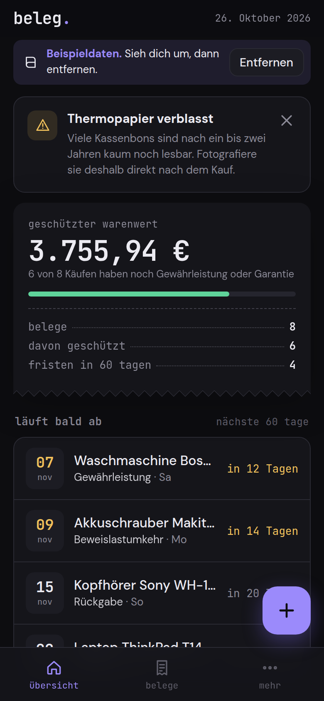
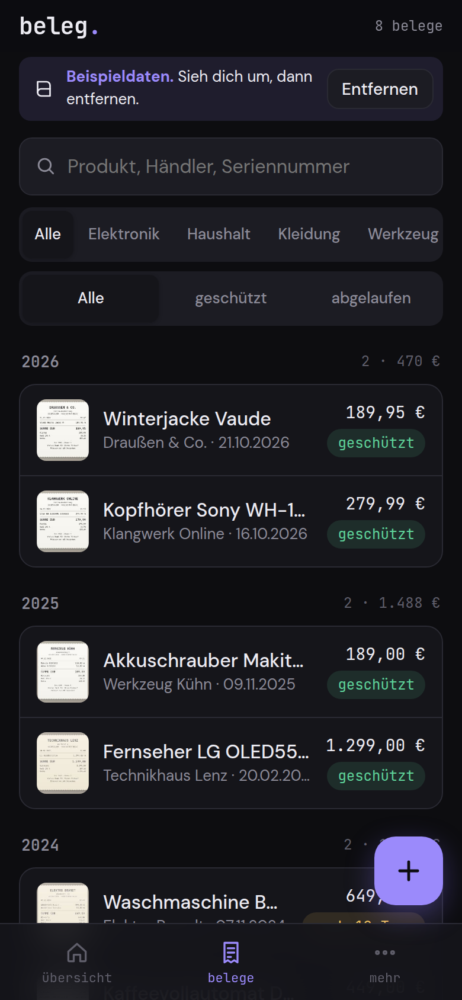
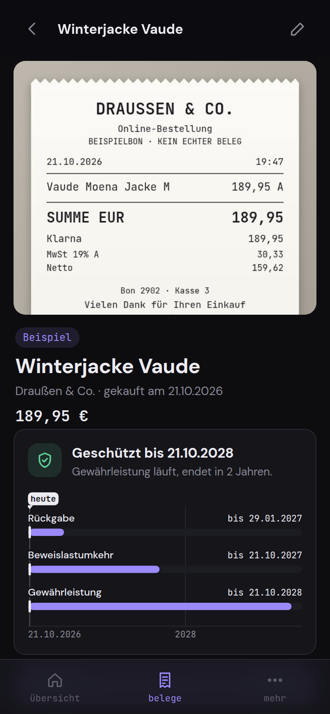

# beleg.

Kassenbon fotografieren, ein paar Felder, fertig. beleg. zeigt dir alle Fristen für Rückgabe, Gewährleistung und Herstellergarantie, erinnert dich rechtzeitig und hilft bei der Reklamation.

Eine offline Handy-App (PWA) von **gedacht.gemacht.** Keine KI, kein Server, kein Konto.

<p align="center">
  
  
  
</p>

## Warum

Der Fernseher geht nach 20 Monaten kaputt. Der Kassenbon ist weg oder auf dem Thermopapier nicht mehr lesbar, und keiner weiß mehr, ob die Gewährleistung noch läuft. beleg. hält den Beleg als Foto fest und rechnet die Fristen für dich aus.

## Funktionen

- **Beleg erfassen:** Bon mit der Kamera fotografieren (mehrere Seiten), aus der Galerie wählen oder eine PDF-Rechnung aus dem Onlineshop anhängen. Fotos werden auf dem Gerät verkleinert.
- **Kontrast für Thermopapier:** optional Graustufen mit Hintergrundausgleich und Kontrastspreizung, damit blasse Bons lesbar bleiben. Reine Bildrechnung, kein ML.
- **Felder:** Produkt, Händler, Kaufdatum, Preis, Kategorie, Gewährleistung (24 oder 12 Monate oder keine), Herstellergarantie, Rückgabefrist, Seriennummer, Notiz. Vorschläge aus deinen bisherigen Einträgen.
- **Fristen:** Rückgabe, Beweislastumkehr, Gewährleistung und Garantie für jeden Beleg, mit Zeitstrahl und Status.
- **Übersicht:** was in den nächsten 60 Tagen abläuft, wie viele Käufe noch geschützt sind und was sie zusammen wert sind.
- **Alle Belege:** Suche in Produkt, Händler, Seriennummer und Notiz, Filter nach Kategorie und Status.
- **Reklamation vorbereiten:** sachliche Mängelanzeige an den Händler mit Bitte um Nacherfüllung nach § 439 BGB und 14 Tagen Frist, mit Hinweis auf die Beweislastumkehr, wenn sie greift. Kopieren, per E-Mail oder teilen.
- **Bon teilen:** Fotos und PDF über das Teilen-Menü des Handys.
- **Erinnerungen:** alle kommenden Fristenden als Kalenderdatei (.ics) mit Alarm 14 Tage und 1 Tag vorher um 9 Uhr. Nach Änderungen neu exportieren.
- **Export:** Liste als CSV für deutsches Excel, Sicherung als JSON inklusive aller Fotos und PDFs, Wiederherstellung auf einem anderen Gerät.
- **Hell und dunkel**, deutsches Zahlen- und Datumsformat, Beispieldaten zum Ausprobieren.

## So rechnet beleg.

| Frist | Rechnung |
|---|---|
| Rückgabe | Kaufdatum + eingetragene Tage |
| Beweislastumkehr | Kaufdatum + 12 Monate (Kauf ab 1.1.2022), davor 6 Monate, höchstens bis Ende der Gewährleistung |
| Gewährleistung | Kaufdatum + Gewährleistungsmonate (gesetzlich 24) |
| Garantie | Kaufdatum + Garantiemonate |

Monatsrechnung wie im Kalender: der 31.1. plus ein Monat ist der 28.2. (im Schaltjahr der 29.2.). Eine Frist gilt bis einschließlich zum Enddatum. Rechtlich beginnt die Gewährleistung mit der Übergabe, beleg. nimmt das Kaufdatum als Näherung.

## Datenschutz

Alles bleibt auf deinem Gerät. beleg. speichert Belege, Fotos und PDFs in der IndexedDB deines Browsers und macht keine Netzwerkzugriffe: keine Analyse, keine Schriften oder Skripte von fremden Servern, keine Konten. Sichere deine Daten regelmäßig über **Mehr · Sicherung exportieren**, denn wenn du die Browserdaten löschst, sind auch die Belege weg. Beim ersten Speichern fragt beleg. den Browser nach dauerhaftem Speicher.

## Installation

1. Den Ordner `beleg/` auf einen beliebigen statischen Webhost legen (zum Beispiel GitHub Pages, Netlify, ein eigener Server). HTTPS ist nötig, damit die App offline funktioniert.
2. Die Adresse im Handybrowser öffnen.
3. Im Browsermenü **Zum Startbildschirm hinzufügen** wählen (iPhone: Teilen · Zum Home-Bildschirm).

Danach startet beleg. wie eine normale App, auch ohne Internet.

Lokal testen:

```sh
cd beleg
python3 -m http.server 8000
```

Dann `http://localhost:8000` öffnen.

## Rechtliches

beleg. gibt allgemeine Hinweise zum deutschen Kaufrecht (§§ 438, 439, 477 BGB) und erzeugt eine Textvorlage. Das ist **keine Rechtsberatung**. Prüfe Fristen und Texte im Einzelfall, bei Streit helfen die Verbraucherzentralen. Die Bedingungen einer Herstellergarantie legt der Hersteller fest.

## Lizenz

GNU Affero General Public License v3.0 (AGPL-3.0), siehe `LICENSE`.

**gedacht.gemacht.** · alles bleibt auf diesem Gerät
